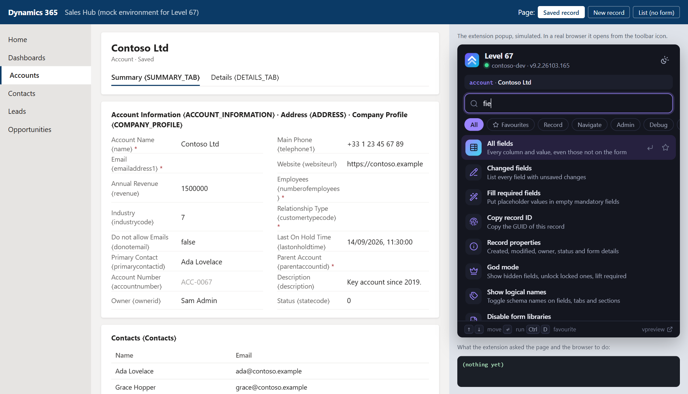
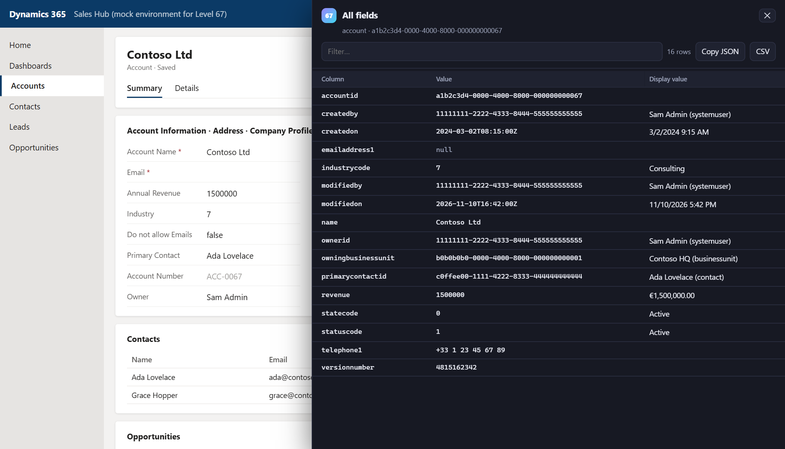
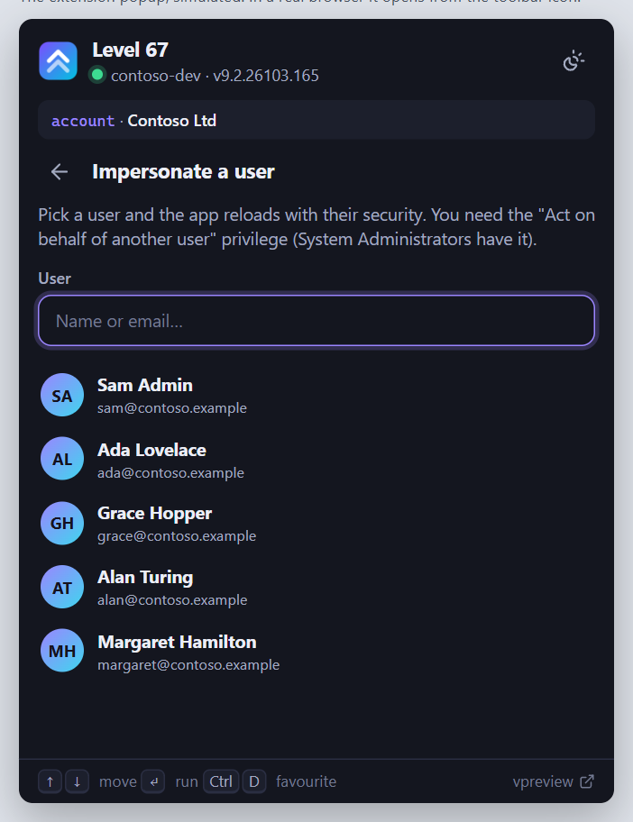

<p align="center">
  
</p>

<h1 align="center">Level 67</h1>

<p align="center">
  <b>A command palette of power tools for Dynamics 365 and Power Apps model-driven apps.</b><br>
  One shortcut, 52 commands, for Chrome, Edge and Firefox.
</p>

<p align="center">
  <a href="https://github.com/Purgator/CrmLevel67/releases/latest"></a>
  
  
  <a href="LICENSE"></a>
</p>



Level 67 is for the people who build, test and support Dynamics 365: makers, developers, functional consultants and admins. Press **Alt+Shift+L** (or click the toolbar icon), type a few letters, press Enter. Show logical names, unlock a form, read every column of a record, impersonate a user, query the Web API, jump to any table.

It is inspired by the excellent [Level up for Dynamics 365/Power Apps](https://github.com/rajyraman/Levelup-for-Dynamics-CRM) by Natraj Yegnaraman, rebuilt from scratch around a search-first palette.

## Contents

- [What it does](#what-it-does)
- [Install it (no technical skills needed)](#install-it-no-technical-skills-needed)
- [How to use it](#how-to-use-it)
- [Permissions and privacy](#permissions-and-privacy)
- [For developers](#for-developers)
- [Credits and licence](#credits-and-licence)

## What it does

| | |
|---|---|
|  |  |
| Results open in a side panel inside the page: filter, click any cell to copy, export CSV or JSON. | Search a user, click, and the app reloads with their security. |

**What makes it different**

- **Search first.** Fuzzy search over every command (`gm` finds *God mode*, `guid` finds *Copy record ID*). Everything is reachable from the keyboard.
- **Favourites and recents.** Star the commands you use (Ctrl+D); your last ones stay on top.
- **Knows where you are.** The header shows the environment, table and record. Commands that need a record explain why they are unavailable instead of failing.
- **Results stay next to your work.** A side panel in the page, with filter, click-to-copy, CSV and JSON export.
- **Light and dark themes**, following your system or forced.
- **Safe by design.** No data leaves your browser. No analytics. No remote code.

### Record

| Command | What it does |
|---|---|
| Show logical names | Toggles schema names on field, tab and section labels |
| God mode | Shows hidden fields, tabs and sections, unlocks read-only fields, lifts required flags |
| Changed fields | Lists the fields with unsaved changes |
| Fill required fields | Puts placeholder values in empty mandatory fields (lookups are left to you) |
| Copy record ID / URL | Copies the GUID, or a shareable link to the record |
| Open record in Web API | Opens the record's raw JSON in a new tab |
| All fields | Every column and value of the record, even those not on the form |
| Record properties | Created, modified, owner, status, version, form name and ID |
| Choice values | The numeric value behind every choice on the form |
| Clone record | Opens a new form pre-filled with this record's values |
| Refresh subgrids / Refresh without saving | Reloads subgrids, or the whole record without autosave |
| Blur sensitive data | Blurs values for screenshots and demos |
| Table processes | Workflows, business rules, flows and actions on the table, with their state |
| Table columns | Column metadata: display, logical and schema names, type, requirement |
| Open form editor | Opens the current form in the Power Apps form designer |

### Navigate

Open record by ID (paste a GUID, or a whole record URL), New record, Open table list (any table, even one hidden from the app), My user record, Advanced find, Power Apps maker portal, Solutions, Power Platform admin center.

### Admin

**Impersonate a user**, plus one-keystroke access to Users, Teams, Security roles, Business units, System jobs, Plug-in trace logs, Processes, Environment variables, Web resources, Mailboxes, Solution history and Advanced settings.

### Debug

Forms monitor, Command checker, Performance center, Disable form handlers, Disable business rules, Disable form libraries, Dynamics dark mode, and Clear debug flags. A banner reminds you when flags are active on the tab.

### Tools

Environment details (organization, IDs, version, user, app), My roles and teams, Count records, **Web API playground** (run GET queries and read the JSON in the page), Web API root, Network diagnostics.

## Install it (no technical skills needed)

Level 67 is not on the extension stores yet. Installing it by hand takes about two minutes.

### Chrome, Edge, Brave

1. **Download.** Open the [latest release](https://github.com/Purgator/CrmLevel67/releases/latest) and click **`Level67-chrome.zip`** under *Assets*.
2. **Unzip.** Find the file in your *Downloads* folder, right-click it and choose **Extract All…** (Windows), or double-click it (Mac). You get a folder named `Level67-chrome`.
   > Move that folder somewhere permanent, like *Documents*. The browser loads the extension from this folder, so do not delete it afterwards.
3. **Open the extensions page.** Type `chrome://extensions` in the address bar (`edge://extensions` in Edge) and press Enter.
4. **Turn on Developer mode.** It is a switch in the top-right corner (bottom-left in Edge).
5. **Load it.** Click **Load unpacked** and select the `Level67-chrome` folder (the one that contains `manifest.json`).
6. **Pin it.** Click the puzzle-piece icon in the toolbar, then the pin next to *Level 67*.

Open your Dynamics 365 app and click the Level 67 icon, or press **Alt+Shift+L**.

To update later: download the new zip, replace the folder's contents, and click the reload arrow on the Level 67 card in `chrome://extensions`. Your favourites are kept.

### Firefox

Firefox 140 or newer. Download **`Level67-firefox.zip`** from the [latest release](https://github.com/Purgator/CrmLevel67/releases/latest). Do not unzip it.

1. Type `about:debugging#/runtime/this-firefox` in the address bar and press Enter.
2. Click **Load Temporary Add-on…** and select `Level67-firefox.zip`.
3. Open your Dynamics 365 app, click the puzzle-piece icon in the toolbar, then **Level 67**. (Right-click it and choose *Pin to Toolbar* to keep it visible.)

> Firefox removes temporary add-ons when it restarts, so you will need to load it again. A permanent install needs the add-on to be signed by Mozilla, which is planned.

## How to use it

| Keys | Action |
|---|---|
| `Alt+Shift+L` | Open the palette (change it in `chrome://extensions/shortcuts`, or *Manage Extension Shortcuts* in Firefox) |
| Type | Search commands |
| `↑` `↓` | Move |
| `Enter` | Run the selected command |
| `Ctrl+D` | Add to or remove from favourites |
| `Esc` | Clear the search, go back, or close |

In the side panel: type to filter, click a cell to copy it, `Esc` to close.

**Impersonation.** Run *Impersonate a user*, search by name or email, pick someone. The tab reloads and the app behaves as that user would see it; the toolbar icon shows an **AS** badge. Open the palette and press **Stop** to return to yourself. It ends by itself when you close the browser. You need the *Act on Behalf of Another User* privilege, which System Administrators have. On an on-premises address, the browser asks you once for access to that site.

## Permissions and privacy

Level 67 has no server and collects nothing. Everything runs in your browser, with your own Dynamics 365 session.

| Permission | Why |
|---|---|
| `activeTab`, `scripting` | Run the command you picked in the tab you are looking at, only when you open the palette |
| `storage` | Remember favourites, recent commands and theme, on your device |
| `clipboardWrite` | Copy record IDs and URLs |
| `declarativeNetRequestWithHostAccess`, access to Dynamics 365 domains | Impersonation only: add the "act as" header to Web API calls of the environment you chose |
| Optional access to other sites | Asked on demand, only to impersonate on an on-premises address |

## For developers

Plain JavaScript, Manifest V3, no framework, no bundler. Node 22 or newer is needed for the tooling only.

```bash
git clone https://github.com/Purgator/CrmLevel67.git
```

```bash
npm install
```

```bash
npm run build
```

`npm run build` writes `dist/chrome/` and `dist/firefox/` (load these unpacked while developing) and the two release archives, `dist/Level67-chrome.zip` and `dist/Level67-firefox.zip`. The build has no dependencies and is reproducible.

### Architecture

```
popup (extension page)                      page (MAIN world of the Dynamics tab)
┌──────────────────────────┐  scripting.   ┌───────────────────────────────────┐
│ popup.js   palette UI    │  executeScript│ engine.js  commands, uses Xrm and │
│ commands.js  registry    │ ────────────► │            the Web API            │
│ fuzzy.js   search        │ ◄──────────── │ ui.js      side panel and toasts  │
└────────────┬─────────────┘   JSON result │            (shadow DOM)           │
             │ runtime.sendMessage         └───────────────────────────────────┘
┌────────────▼─────────────┐
│ background.js            │  declarativeNetRequest session rule:
│ impersonation            │  adds CallerObjectId / MSCRMCallerID to /api/data/
└──────────────────────────┘
```

- **The popup never touches Dynamics.** It injects `page/ui.js` and `page/engine.js` into the tab's MAIN world (where `Xrm` lives) and calls `window.__level67.run(id, args)`. Results come back as plain JSON: `{ ok, toast, copy, open, error }`. The popup then copies, opens tabs and closes.
- **`activeTab` instead of broad host access.** Injection is allowed because the user opened the palette, so it works on any address, on-premises included, without asking for every site.
- **In-page UI lives in a shadow root** and is built with `createElement` and `textContent` only: record data is untrusted and Dynamics pages may enforce a strict CSP.
- **Impersonation** is a session rule that sets `CallerObjectId` (Entra object ID, online) or `MSCRMCallerID` (on-premises) on Web API requests of one origin. State lives in `storage.session`; nothing survives a browser restart.
- **Both browsers share all the code.** Only the manifest differs: `background.service_worker` for Chromium, `background.scripts` plus the Gecko settings for Firefox. `scripts/build.mjs` generates both.

### Layout

| Path | Role |
|---|---|
| `src/manifest.json` | Base manifest; the build adds the per-browser keys |
| `src/shared/commands.js` | Command registry: id, title, description, category, icon, requirements, inputs |
| `src/shared/fuzzy.js` | Fuzzy matcher and ranking |
| `src/shared/icons.js` | Generated icon sprite ([Lucide](https://lucide.dev)) |
| `src/popup/` | The palette |
| `src/page/engine.js` | One handler per command, plus context detection |
| `src/page/ui.js` | Side panel, Web API playground, toasts |
| `src/background.js` | Impersonation rules and badge |
| `scripts/` | `build.mjs`, `preview.mjs`, `make-icons.mjs`, `screenshots.mjs` |
| `test/` | Unit tests, Xrm and extension API mocks, end-to-end tests |

### Develop without an org

```bash
npm run preview
```

Opens a fake Dynamics 365 page on <http://localhost:6767/> with the real popup docked beside it. `Xrm`, the Web API and the extension APIs are mocked (`test/mock/`), so every command can be tried in any browser, without installing the extension or signing in anywhere. Switch between a saved record, a new record and a list page from the top bar.

### Tests

| Command | What it covers |
|---|---|
| `npm test` | Unit tests (`node:test`): every engine command against the Xrm mock, the registry, fuzzy search, the build output |
| `npm run test:e2e` | The built Chrome package in headless Chrome: real popup, real injection, real impersonation rule checked on the wire |
| `npm run test:e2e:firefox` | Same for the Firefox package in headless Firefox (needs Firefox installed) |
| `npm run lint:firefox` | Mozilla's `web-ext lint` on the Firefox package |
| `npm run test:all` | Unit tests and both end-to-end suites |

The end-to-end suites patch a copy of the manifest to allow `localhost`; the shipped manifest is never widened.

### Add a command

1. Add an entry to `COMMANDS` in `src/shared/commands.js`. Use `needs: 'form'` or `needs: 'saved'` if it requires a record, and `input: [...]` if it needs values from the user.
2. Add a handler with the same id in `src/page/engine.js`. Return `{ toast }`, `{ copy }`, `{ open }`, or call `ui().panel(...)`. Throw an `Error` with a message meant for the user.
3. If you used a new icon, run `npm run icons`.
4. Add a test in `test/engine.test.mjs`. A registry test fails if a command has no handler, or the reverse.

### Release

Bump the version in `package.json`, `src/manifest.json` and the `VERSION` constant of `src/page/engine.js` and `src/page/ui.js` (the build refuses mismatches), run `npm run test:all`, then `npm run build` and attach the two zips from `dist/` to a GitHub release.

## Credits and licence

- Inspired by [Level up for Dynamics 365/Power Apps](https://github.com/rajyraman/Levelup-for-Dynamics-CRM) by Natraj Yegnaraman and its contributors. Level 67 shares no code with it.
- Icons by [Lucide](https://lucide.dev) (ISC License).
- Not affiliated with or endorsed by Microsoft. Dynamics 365 and Power Apps are trademarks of Microsoft Corporation.

Licensed under the [GNU General Public License v3.0 or later](LICENSE).
